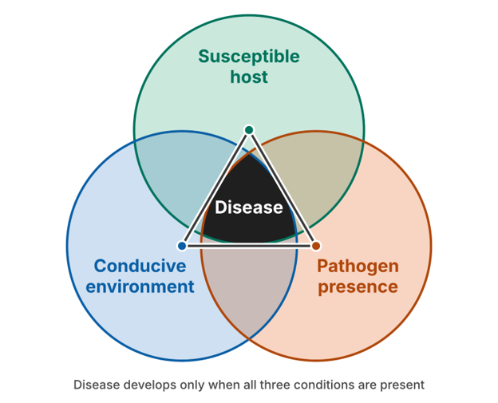
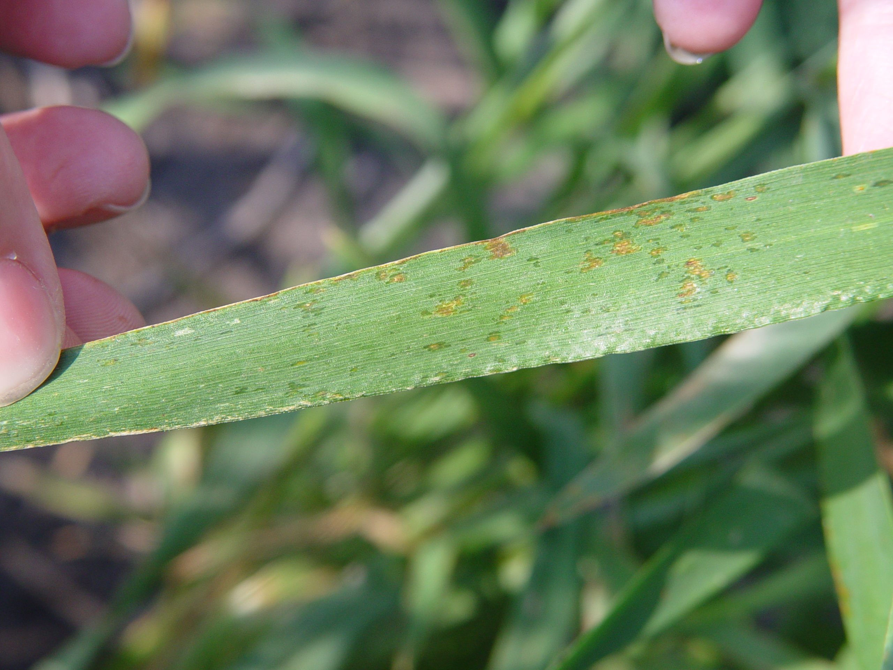
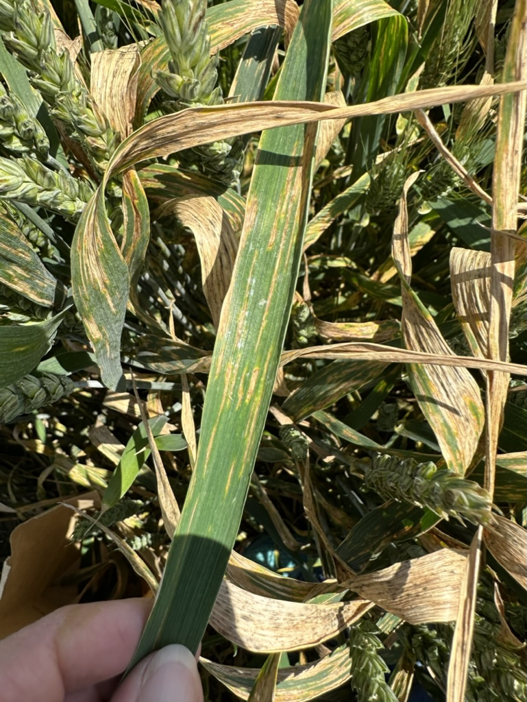
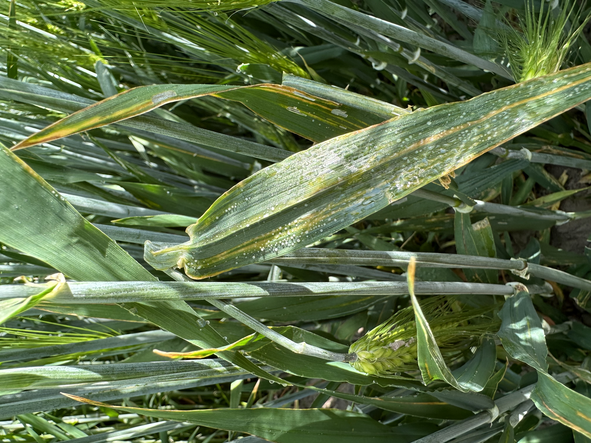
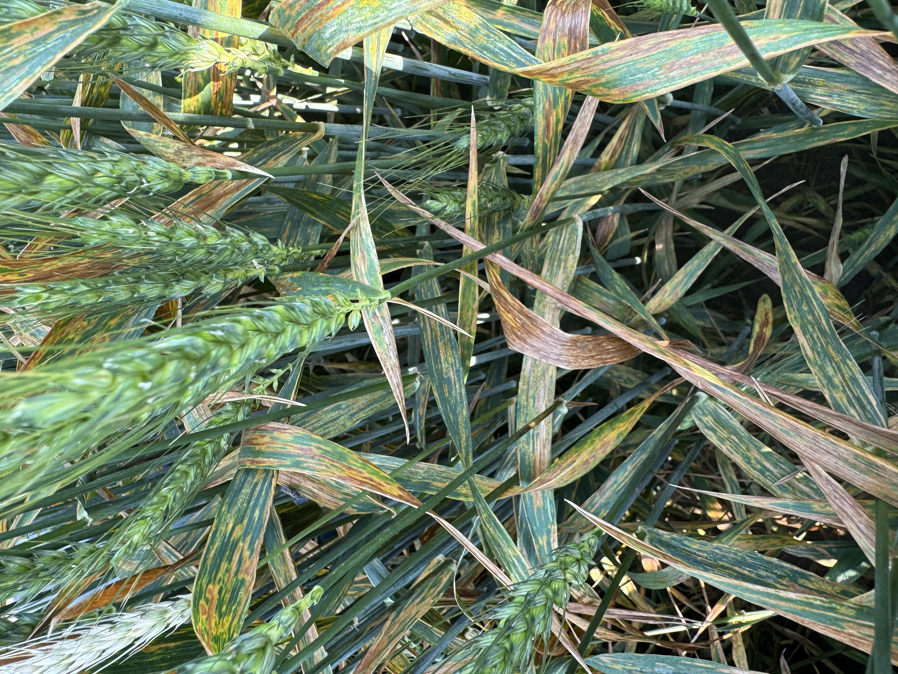
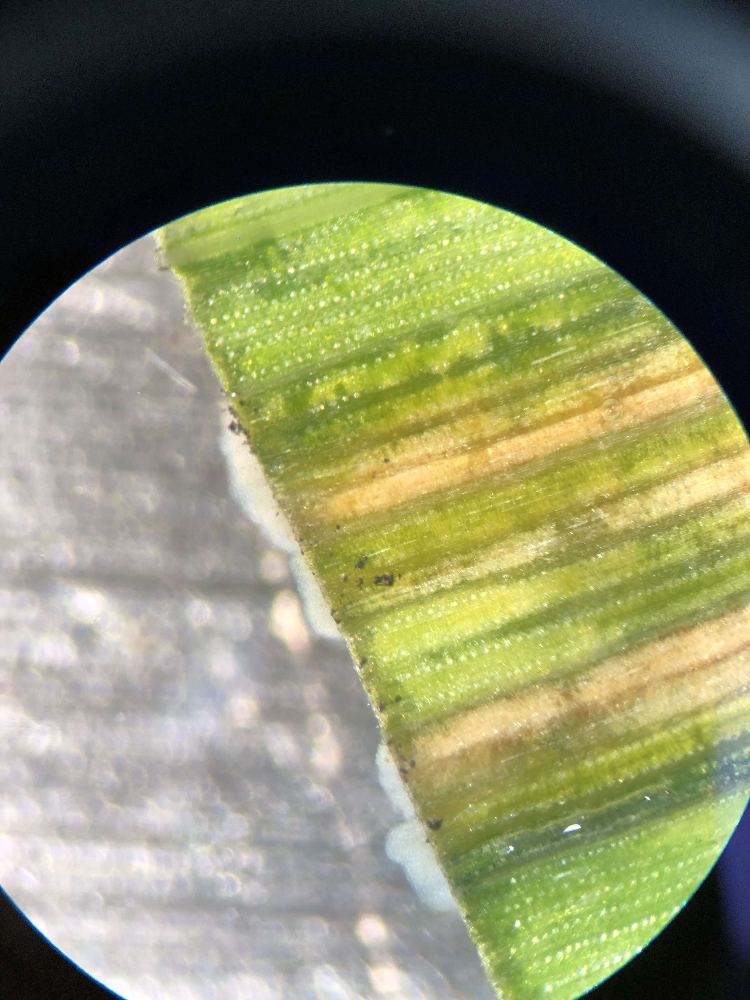

## Introduction

Plant health management begins long before planting and involves all aspects of crop production – from crop rotation, soil fertility and irrigation management to variety selection. Disease management in cereals and in all crop production depends on preventive measures such as crop rotation and crop diversity. In contrast to many weed and insect problems, chemical controls are either not available or not economically feasible for most wheat diseases after infection has occurred. Crop rotations can reduce inoculum levels of pathogens, seeding dates influence the types of pathogens that affect the crop, and the use of certified seed and disease-resistant varieties reduces the risk and impact of disease on wheat production.\

Wheat in Pacific Northwest (PNW) production areas is affected by multiple diseases, depending on the growth habit (winter versus spring), production system (no-till versus conventional tillage), production zones (dryland, rainfed, or irrigated), and the many microclimates or environments where production occurs. More detailed descriptions of these diseases and recommended controls are available in the *Compendium of Wheat Diseases and Pests*, Third Edition (APS Press, 2010), and *A Farmer’s Guide to Wheat Diseases* (APS Press, 2020). Disease and crop protection information is also available online, including the [Crop Protection Network (CPN)](https://cropprotectionnetwork.org/), a website supported by land-grant universities that provides unbiased, collaborative information on important issues affecting field crops in the United States and Canada. An additional resource for PNW growers is the [PNW Plant Disease Management Handbook](https://pnwhandbooks.org/plantdisease), which is updated every year and lists registered products, and Fungicides for Field Crops (APS Press, 2013).\ 

Wheat disease development requires a susceptible host or variety, a virulent pathogen, and a conducive environment. Disease management, therefore, involves manipulating one or more of these three elements to suppress disease and achieve a biological and economic benefit (@fig-conditions). Complete disease control is seldom necessary and frequently not economically feasible. Appropriate crop rotations reduce pathogen populations. Adjusting seeding dates can help the crop avoid pathogens that may be present in soil or crop debris. Planting certified, pathogen-free seed of disease-resistant varieties is encouraged, not only to limit disease development but also to reduce pathogen populations and weed seed reservoirs. Other practices, such as nutrient supplementation or pesticide applications, may promote plant health, discourage disease development, and improve crop performance.\ 

{#fig-conditions}

In a broad sense, a disease is any abnormality in plant function that causes physiological changes, which may eventually be expressed as visible symptoms. Yellowing, distorted or stunted growth, wilting, spots, rots, and discolored tissues are some of the indications of disease. Such symptoms may result from infectious or noninfectious agents and are often not specific enough to identify the cause easily.\ 

Noninfectious diseases include disorders and stresses caused by mechanical or environmental factors such as nutrition, temperature, moisture, and toxicants. Infectious diseases, which are the primary focus of this discussion, are caused by biotic (living) plant pathogens such as fungi, oomycetes (water molds), bacteria, and nematodes. Viruses and virus-like agents, although not technically living organisms, also cause infectious disease. These agents can multiply, spread from plant to plant, and cause new infections.\ 

Wheat is susceptible to many infectious diseases. At any given time, wheat may serve as a host for several different pathogens and bear symptoms of several different diseases. Fortunately, most wheat crops are significantly affected by only two or three diseases each season. The most commonly-encountered diseases vary with production system and growth habit. Diseases frequently affecting dryland winter wheat include barley yellow dwarf, wheat streak mosaic, stripe rust, and root and foot rots caused by *Bipolaris, Rhizoctonia, Fusarium, Pythium,* and other soilborne fungi and oomycetes. In higher-precipitation ("rainfed") zones, soilborne wheat mosaic affects certain areas of the Palouse. High-rainfall areas and irrigated production also may be affected by strawbreaker foot rot (eyespot), take-all, Cephalosporium stripe, snow molds and dwarf bunt.\ 

Spring cereals face different threats and are more frequently affected by early-season soilborne diseases such as Pythium root rot, which is favored by cold, wet soils typical of spring planting conditions. Fusarium head blight (FHB) occurs more frequently in spring grain as warmer temperatures coincide with heading, favoring fungal infection by various *Fusarium* fungi. While winter wheat may be affected by the same diseases as spring grain, damage may be limited due to "avoidance." Winter crops establish a healthy root system in the fall that either withstands minor infection in the spring or avoids pathogens altogether. Examples include winter cereals avoiding Pythium infection by planting into warm, dry soils, and reduced susceptibility to cereal cyst nematode damage by having an established root system prior to nematode hatching in early spring[^see-14]. Winter cereals are significantly more susceptible to FHB but are heading and at anthesis (flowering) prior to optimum temperatures for head infection.\ 

[^see-14]: See [Chapter 14](14_nematodes.qmd) for a discussion of nematodes affecting wheat.

## Foliar diseases

### Bacterial leaf diseases

#### Bacterial streak: *Xanthomonas campestris* pv. *undulosa*

The main bacterial disease of wheat appears at two plant growth stages: during vegetative growth, and during and after heading. Infections at heading on glumes and awns are called black chaff (see description and photos in @sec-spike-seedborne). Bacteria are found in plant residue in and on the soil and on various grasses at field edges. The bacteria can also be seedborne, which provides inoculum for the next growing season; however, the seed transmission rate is very low. The bacterial causal agent (*Xanthomonas* spp.) is found wherever wheat is grown and enters the plant through wounds. Early-season infections occur after plant surfaces are wounded by frost, sleet or windblown sand (@fig-bac-early). As the growing season advances, bacterial growth and spread increase rapidly as temperatures rise.\  

::: {style="float: right; margin-left: 15px; margin-bottom: 10px;"}

{#fig-bac-early width="350px"}
:::

Bacterial streak is primarily a problem in irrigated wheat where bacteria are rapidly spread by irrigation water and splashing rain. Symptoms appear initially as water-soaked streaks and spots that eventually turn brown and may be surrounded by a lime-green halo (@fig-bac-wheat). Lesions on the leaf may appear translucent when held up to the light and have a dark brown-black tone (@fig-bac-barley). Symptoms may also appear as dark purple discoloration of the upper stem between the head and flag leaf (@fig-bac-sym1). Under humid and wet conditions, bacteria ooze onto the leaf surface in yellowish, milky droplets that then dry into shiny, reflective flakes resembling fish scales that flake off and blow with the wind. Leaves can become sticky to the touch. Confirmation of bacterial streak can be done by placing a cut leaf underwater and observing bacterial ooze at low magnification (@fig-bac-sym2).\ 

::: {#fig-bacterial-streak layout-ncol=2}

{#fig-bac-wheat group="bacterial-streak1" width="250px"}

{#fig-bac-barley  group="bacterial-streak1" width="250px"}
Bacterial streak symptoms appear initially as water-soaked streaks and spots that eventually turn brown and may be surrounded by a lime-green halo.

:::

::: {#fig-bac-symptoms layout-ncol=2}

{#fig-bac-sym1}

{#fig-bac-sym2}

Bacterial streak symptoms.

:::

Severe infections can reduce yields by as much as 40% and can be seen in circular discolored areas of the field after heading (Fig 12.2.5) and at harvest (Fig 12.2.6). Test weight can also be reduced. The disease cannot be controlled once plants are infected. Planting certified seed, which is inspected during the previous growing season, reduces disease. Reduce spread within the field by irrigating less often for longer periods (i.e., slowing the pivot to apply more water per rotation). Grassy weeds on canal banks and field edges, as well as crop debris, serve as reservoirs for the bacteria.\ 

## Spike and seed-borne diseases {#sec-spike-seedborne}
***section text***

Learn more:  
[Seedborne Diseases of Cereals](https://objects.lib.uidaho.edu/uiext/uiext30078.pdf)  

## Soil-borne diseases
***section text***

