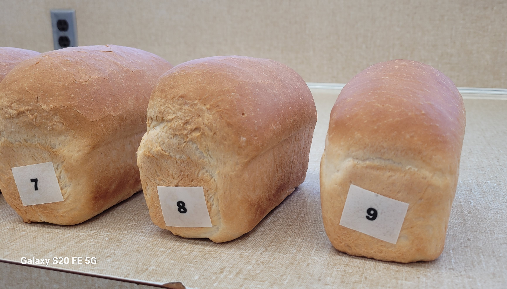

*Image: J Piaskowski*

## Introduction

Wheat is not a uniform commodity. It is a raw material for a wide range of foods and industrial products used worldwide. This reality underscores a core principle: **quality is paramount**. When millers, bakers, or other end users encounter processing difficulties, the value of a lot declines. The following sections summarize the factors that create quality variation—what makes grain more or less valuable.  

Different end products demand flours with specific functional properties to meet processing and finished product targets. Suitability is largely determined by:  

::: {.indent-border} 

  *	Kernel texture (hardness)  
  *	Starch characteristics  
  *	Gluten composition, which governs dough strength, extensibility, and handling.
  
:::  

::: {.p-spaced}

Matching a wheat variety to its appropriate end-use product begins with assessing **composition** and **milling potential**. Routine tests quantify moisture, protein, kernel texture, grain soundness, ash, and related components. Composition provides a first approximation of processing potential.  

More reliable prediction requires tools that measure or model the functional behavior of flour, dough, or key constituents (e.g., gluten, starch, arabinoxylans). Common approaches include:

:::

::: {.indent-border}

  *	Starch and flour pasting properties  
  *	Solvent Retention Capacity (SRC)  
  *	Dough testing and rheological prediction of dough properties

:::

### Quality and Production in Idaho and the PNW 

In Idaho and the Pacific Northwest, soft white wheat is primarily used for cookies, crackers, cakes, batters and breadings, and selected noodle types. Hard red spring and hard red winter wheats are preferred for tortillas, yeast leavened pan and hearth breads, and yellow alkaline noodles requiring stronger gluten. Across these applications, regional wheats are noted for efficient milling, producing bright, low-ash flours with high extraction rates and consistent baking performance.  

Wheat quality is genetically complex. Breeders, in close collaboration with cereal chemists, are responsible for ensuring new varieties meet milling and baking requirements. Varieties are developed to align with established market classes and grades, supporting predictable performance from field to finished product.  

By aligning production with end-use specifications and delivering clean, sound grain, Idaho and PNW growers ensure the value of their crop, strengthen buyer confidence, and sustain the region’s reputation for high-quality flours with reliable end-use performance.  

## Classes and grading {#sec-classes-and-grading}

### The U.S. System of Classes {#sec-classes}

The U.S. system of marketing wheat relies on statutory standards set out by Congress and administered by the Federal Grain Inspection Service (FGIS) in the Grain Inspection, Packers, and Stockyards Administration (GIPSA) of the U.S. Department of Agriculture and its approved state inspection agencies. The standards define wheat classes and set out the rules for determining grades within classes. The standards have evolved over time to reflect important issues and concerns of the marketplace.  

The official standards currently list the following eight classes and subclasses of wheat:  



<!--1. **Durum wheat.** All varieties of white (amber) durum wheat. This class is divided into the following three subclasses:  

   i) Hard Amber Durum wheat. Durum wheat with 75 percent or more of hard and vitreous kernels of amber color.  
  
   ii) Amber Durum wheat. Durum wheat with 60 percent or more but less than 75 percent of hard and vitreous kernels of amber color.  
  
   iii)	Durum wheat. Durum wheat with less than 60 percent of hard and vitreous kernels of amber color.  
  
2. **Hard Red Spring wheat.** All varieties of Hard Red Spring wheat. This class shall be divided into the following three subclasses:  

   i)	Dark Northern Spring wheat. Hard Red Spring wheat with 75 percent or more of dark, hard, and vitreous kernels.  
  
   ii) Northern Spring wheat. Hard Red Spring wheat with 25 percent or more but less than 75 percent of dark, hard, and vitreous kernels.  
  
   iii) Red Spring wheat. Hard Red Spring wheat with less than 25 percent of dark, hard, and vitreous kernels.  
  
3. **Hard Red Winter wheat.** All varieties of Hard Red Winter wheat. There are no subclasses in this class.  

4. **Soft Red Winter wheat.** All varieties of Soft Red Winter wheat. There are no subclasses in this class.  

5. **Hard White wheat.** All hard endosperm white wheat varieties. There are no subclasses in this class.

6. **Soft White wheat.** All soft endosperm white wheat varieties. This class is divided into the following three subclasses:  

   i) Soft White wheat. Soft endosperm white wheat varieties which contain not more than 10 percent of white club wheat.  
  
   ii) White Club wheat. Soft endosperm white club wheat varieties containing not more than 10 percent of other soft white wheats.  
  
   iii) Western White wheat. Soft White wheat containing more than 10 percent of white club wheat and more than 10 percent of other soft white wheats.  
  
7. **Unclassed wheat.** Any variety of wheat that is not classifiable under other criteria provided in the wheat standards. There are no subclasses in this class. This class includes any wheat which is other than red or white in color.  

8. **Mixed wheat.** Any mixture of wheat that consists of less than 90 percent of one class and more than 10 percent of one other class, or a combination of classes that meet the definition of wheat.
-->

{#fig-classes-map}

### The U.S. System of Grades {#sec-grades}

In addition to class and subclass, individual lots of wheat receive a **grade**. Grades aim to describe in general terms the relative quality of different grain lots within a market class. As such, grade-determining factors largely reflect aspects of a grain lot that would pose a processing problem or advantage, or a potential health or sanitation concern. 

@tbl-grades lists the current grade-determining factors for wheat; a brief explanation of each and why it is important follows. Before the grade-determining factors are measured, dockage is removed. Dockage is mostly non-wheat material that can be easily removed by sieving and is separated using the Carter Dockage Tester. Dockage also includes underdeveloped, shriveled, and broken kernels that cannot be easily recovered from the separated portion. Dockage, foreign material, and shrunken and broken kernels, besides being costly to separate, represent non-millable material. Any value associated with this material often depends on the availability of pelletizing equipment and the proximity of feed markets.  

It must be emphasized that although limits for damaged kernels, foreign material, and shrunken and broken kernels are set by the standards that determine official grade, customers may specify tighter limits. Also, although dockage is not a grade-determining factor, many of our "cash" customers overseas are setting tighter limits in their contract specifications. For example, contracts may specify maximum dockage in the range of 0.5 to 1 percent, but may further require that the dockage present be subtracted from the delivered weight.  

Increasingly, 2-to 3-fold discount penalties are applied for dockage levels above certain thresholds. Similarly, pressure continues to reduce levels of foreign material and shrunken and broken kernels. Recent analysis indicated that to be fully competitive with Australia and Canada, our industry would need to be able to consistently offer cleaned wheat with maximum 0.2 percent dockage, 0.2 percent foreign materials, and 0.7 percent shrunken and broken kernels. The message is clear: deliver cleaner wheat that is more nearly all convertible to flour. 

::: {.border}
:::

#### Wheat Grades and Grade Requirements

![(a) Grades and grade requirements for all classes of wheat, except Mixed wheat.  
(b) Grades and grade requirements for Mixed wheat. Mixed wheat is graded according to the U.S. numerical and U.S. Sample grade requirements of the class of wheat that predominates in the mixture, except that the factor wheat of other classes is disregarded.[^standards]](figs/19_1_us_wheat_standards.png){#tbl-grades width=100% .nolightbox}  

[^standards]: Table Source: [United States Standards for Wheat – Grades and grade requirements for wheat. 7 CFR 810.2204.](https://www.ams.usda.gov/sites/default/files/media/WheatStandards.pdf)  

#### Grade-Determining Factors

Expand grading factors below for a brief explanation of each and how it is used.  

::: {.wpg title="Test weight" collapse="true" icon="false"}

The purpose of test weight is to provide an estimate of the plumpness of the wheat kernel and therefore its potential for efficient milling into white flour of bright color and low ash content. Test weight also serves as a means of estimating the volume-bushel (weight) relationship in storage. Recently, there has been considerable controversy on this topic, however, especially among growers of soft red winter wheat.

:::

::: {.wpg title="Heat damaged kernels" collapse="true" icon="false"}

Heat damage reflects a prior history of adverse storage or handling conditions. Grain that was too wet in storage and thus suffered microbiological and physiological activity becomes heat damaged. For this reason, and the fact that heat damaged kernels cannot be readily cleaned out, fairly strict limits are set.

:::

::: {.wpg title="Damaged kernels (total)" collapse="true" icon="false"}

In addition to heat-damaged kernels, the Standards specify limits on "badly ground-damaged, badly weather-damaged, diseased, frost-damaged, germ-damaged, insect-bored, mold-damaged, sprout-damaged, or otherwise materially damaged" kernels. Percentages are determined on the basis of kernels, pieces of kernels, and other grains which remain after removing kernels in Dockage and Shrunken and Broken categories.\

Probably the most notorious of these for PNW growers is sprout damage. On a regular basis, sprout is not a serious regional problem. Occasionally, however, untimely rains delay harvest and may cause serious problems. The problem is exacerbated by the general lack of seed dormancy in our white wheat varieties and the relatively low tolerance of many soft white wheat end-products to $\alpha$-amylase - the main enzyme associated with sprout.

:::

::: {.wpg title="Foreign material" collapse="true" icon="false"}

Foreign material includes all matter other than wheat that remains in the sample after dockage and shrunken and broken kernels are removed. Since foreign material is not easily removed by sieving and, by definition, it is not wheat, it presents more of a problem to the flour miller. Added expense is incurred as more elaborate cleaning processes are employed to remove the material.

::: 

::: {.wpg title="Shrunken and broken" collapse="true" icon="false"}

Often referred to as "S & B", shrunken and broken refers to all material removed by sieving on a 0.064 x 3/8 inch oblong-hole sieve. S & B is determined after dockage is removed.

:::

::: {.wpg title="Defects (total)" collapse="true" icon="false"}

The sum of damaged kernels, foreign materials, and shrunken and broken cannot exceed the maximum limit set for each grade. For example, U.S. No. 1 Soft White Wheat may contain up to 2.0 percent total damaged kernels, 0.4 percent foreign material, or 3.0 percent shrunken and broken, but the total of the three cannot exceed 3.0 percent. Wheat that contained all three of these at the maximum level specified for U.S. No. 1 wheat would have 5.4 percent total defects and consequently would grade U.S. No. 3.

:::

::: {.wpg title="Wheat of other classes" collapse=true icon=false}

Wheat of other classes is divided into *Contrasting Classes* and *Wheat of Other Classes, Total*. The limits set for wheat of contrasting classes is more strict than for Wheat of Other Classes, reflecting the greater problem of having wheat with contrasting end-uses. For both Soft and Hard White wheats, the contrasting classes are Hard Red Spring, Hard Red Winter, Soft Red Winter, Durum, and Unclassed wheats. For Hard Red Spring and Hard Red Winter wheats, contrasting classes are Durum, Hard White, Soft White, and Unclassed wheats.

:::

::: {.wpg title="Special grades and classifications" collapse=true icon=false}

Special grades and classifications relate to certain specific problems or contaminants in a grain lot. They include such things as ergotty wheat, light smutty wheat, and smutty wheat. For more information on the special grades, refer to the official standards.

:::

::: {.callout-tip icon=true collapse=false}
### Learn more about wheat grading and classes:

[Working with Buyers: Wheat Classes - US Wheat](https://www.uswheat.org/working-with-buyers/wheat-classes/)  

[Working with Buyers: Wheat Grades and Grade Requirements - US Wheat](https://www.uswheat.org/working-with-buyers/wheat-grade-factors/)  

[Grain Grading Primer - USDA-ARS/FGIS](https://www.ams.usda.gov/sites/default/files/media/GrainGradingPrimer11272017.pdf)  

[Market Information - US Wheat](https://uswheat.org/market-information/)  

::: 

## Falling number

**Alpha-amylase** is a naturally occurring enzyme in wheat kernels that breaks down complex starch molecules into simple sugars, which provide an energy source for the germinating seed. Although this process is essential for sprouting, the production of high-quality wheat flour and wheat-based products depends on the presence of intact starch granules. Excessive alpha-amylase activity can degrade these starches and negatively affect flour functionality and end-product performance.\

The **Falling Number test** is used to assess the level of starch degradation caused by alpha-amylase activity in wheat meal or flour. During the test, a measured quantity of ground wheat or flour is combined with distilled water in a glass tube containing a stirrer and mixed to create a slurry. The tube is then placed in a boiling water bath while the sample is continuously stirred. As the mixture heats, the starch gelatinizes and forms a viscous paste.\

The Falling Number instrument evaluates the **viscosity** of this paste by measuring the time required for a standardized stirrer to descend through the sample. Results are reported as a Falling Number value in seconds and serve as an indicator of alpha-amylase activity.\  

::: {.indent-border}

  * Higher Falling Number values, typically **above 300 seconds**, indicate low enzyme activity and sound wheat or flour quality.\  
    
  * Lower values, generally **below 250 seconds**, indicate elevated enzyme activity and are commonly associated with sprout-damaged wheat or flour.\

:::  

::: {.p-spaced}
For many wheat markets, particularly those serving international export channels, only grain lots with Falling Number values of **300 seconds or greater are accepted**. In the Pacific Northwest (PNW) region of the United States, soft white wheat is the predominant class produced. Market contract specifications for both soft white and western white wheat generally require a Falling Number of at least 300 seconds. Grain lots falling below this threshold are typically subject to price discounts, regardless of their actual impact on end-product quality.\

:::

### Causes of Low Falling Number

Low Falling Number (LFN) can negatively affect wheat quality and market value. In the Pacific Northwest, four primary factors contribute to low Falling Number values:\

::: {.indent-border} 
  *	**Green Kernels:** Immature kernels can substantially reduce Falling Number, even when present in small amounts. Harvesting at full maturity is the most effective prevention strategy.\

  *	**Preharvest Sprouting (PHS):** Moisture exposure after grain maturity can initiate sprouting, increasing alpha-amylase activity and lowering Falling Number. Tolerant varieties provide the best protection against PHS.\

  *	**Late-Maturity Alpha-Amylase (LMA):** Cool temperatures during the soft dough stage can trigger elevated alpha-amylase activity without visible kernel damage. Growing tolerant varieties and, when conditions allow, delaying harvest may help mitigate impacts.\
  
  *	**Non-Alpha-Amylase Induced Low Falling Number (NAIL):** Environmental stress during early grain development can result in low Falling Number without increased alpha-amylase activity. Affected grain often has low protein content. Variety selection and, in some cases, post-harvest blending can help manage NAIL-affected grain.\

:::

::: {.p-spaced}
**Understanding the cause of low Falling Number is critical for selecting appropriate management practices and minimizing economic losses.**\

:::

### Disease Pressure Resulting in Low Falling Numbers

::: {.border}
:::

#### Impacts of LFN on End-Use Products

The level of enzyme activity measured by the Falling Number test indicates wheat flour functionality and end-product quality. Excessive alpha-amylase activity breaks down starch into simple sugars, resulting in reduced starch content and an excess of sugars. Because starch provides the structural framework in products such as bread, cakes, cookies, and noodles, excessive enzyme activity can negatively affect both processing and product performance.\

Wheat flour with high alpha-amylase activity often produces sticky doughs, thin batters, reduced loaf volume, and undesirable texture characteristics in finished products. During processing, affected doughs may become difficult to handle due to increased stickiness and tackiness.\

While wheat flour with very high Falling Number values (indicating low enzyme activity) can often be corrected by adding enzymes during milling or baking, when Falling Number values are too low, the excess alpha-amylase cannot be removed from the wheat or flour. As a result, severely affected grain may have limited marketability and may be unsuitable for many end-use applications.\

{.img-wpg #fig-fn-bread group="fn-bread-cake"}  
  
{.img-wpg #fig-fn-cake group="fn-bread-cake"}  
  
  
::: {.callout-note collapse="false" icon="true"}
#### Suggestions for Reducing Risk of LMA[^academy2024] 

[^academy2024]: Source: [WSU Wheat Academy 2024: Falling Numbers](https://wpcdn.web.wsu.edu/cahnrs/uploads/sites/16/2025/01/Wheat-Academy-2024_Falling-Number.pdf)  

*	Avoid cultivars known to be PHS or LMA susceptible[^susceptible].\

[^susceptible]: Check resources for varieties with FN tolerance.

*	Harvest wheat quickly after it reaches harvest maturity to reduce the risk of getting rained on.\

*	Avoid harvesting green plants since green kernels have higher alpha-amylase.\

*	It is better to harvest fields separately and keep them separate if they matured at different times. It is less likely an isolated cold shock or rain event will both early and late fields.\

*	If you have moderately low falling numbers (200-300 sec), it can’t hurt to store it for a while (2-3 months) to see if your FN rises.\

#### Variety selection resources:

[Preferred Variety List published by WSU](https://wwql.wsu.edu/preferred-varieties/)  
    
[Small Grains Variety Selection Tool](https://varietyselection.cahnrs.wsu.edu/)  
    
[Small Grains Reports (South central and southeast Idaho)](https://www.uidaho.edu/extension/food/cereals/scseidaho)  

::: 

::: {.callout-tip icon="true" collapse="false"}
### Additional Links and Resources for Falling Numbers

[Steber Lab - USDA-ARS Wheat Health, Genetics, and Quality Research Unit](https://www.steberlab.org/)  

 * Over 10 years of Falling Numbers data from WSU Wheat variety trials, and a research publication archive. Explore FN data by year, class, location, variety, and falling numbers vs. yield.  

[WSU Wheat & Small Grains - Grain Quality Resources](https://smallgrains.wsu.edu/ffar/)  

 * Detection and Management Tools for Low Falling Number in the 'Grain Chain'. Ongoing project to develop and validate tools, including a wheat quality test, that are more accessible to the wheat industry.  
    
[WSU Extension - Managing the Risk of Low Falling Numbers in Wheat (2016)](https://pubs.extension.wsu.edu/managing-the-risk-of-low-falling-numbers-in-wheat)  

:::
    
### Video Resources: Falling Number  

::: {layout-ncol=2}









::: 

## Quality tests and interpretations

### Grain Quality Criteria

**High-quality flour starts with high-quality grain.** The higher the grade, the higher the end use quality. The interactions between genetics[^see-4] and environment[^see-8-9] affect the quality of the grain. USDA Federal Grain Inspection Service has grade standards that define the parameters that must be met to meet grade standards[^stds-official].  

Among the grade traits are test weight, lack of shrunken and broken seeds, and lack of other foreign material, insect parts, and wheat of other classes. The grade standards ensure plump clean grain reaches the market. Among the optional grade traits are protein content, kernel texture (defining hard vs soft wheats), and lack of preharvest sprouting or other source of excess enzyme load.  

See @sec-grades for further information on grain grading.\

[^see-4]: see Chapter 4 - [Wheat varieties and breeding](4_wheat_varieties_breeding.qmd)  
[^see-8-9]: see Chapters 8 - [Irrigation management](8_irrigation_management.qmd) and 9 - [Nutrient management](9_nutrient_management.qmd)  
[^stds-official]: see [7 CFR Part 810 Subpart M United States Standards for Wheat](https://www.ecfr.gov/current/title-7/subtitle-B/chapter-VIII/subchapter-A/part-810/subpart-M) for official grading standards  

::: [.border]  
 
:::  

### Flour Quality Criteria

Flour quality is best understood as a combination of performance and consistency, both of which are influenced by the interplay of genetics, environment, agronomic practices, milling, and end-use processes (Kweon et al.). Consequently, evaluating flour quality is a critical step for breeders, millers, and end users in selecting wheat cultivars that deliver superior performance across cultivation, milling, and end use applications.\

Wheat serves as a foundational ingredient in an extensive range of products, including cookies, cakes, pastries, pan breads, flatbreads, steamed breads, noodles, pasta, muffins, and bagels. To meet optimal product specifications, each product requires wheat flour specifically suited to its processing and quality requirements (Ross, 2009).\

This discussion will focus primarily on the fundamentals of wheat flour quality and the most commonly used laboratory quality tests: milling performance, Sedimentation Tests, Solvent Retention Capacity (SRC) tests, mixographs/farinographs, sedimentation, and baking evaluations.

### Introducing the Fundamentals of Wheat Flour End-Use Quality

{#fig-fundamentals width="65%"}  

<!--begin gallery -->
::: {layout-nrow=2}

::: {.expand-box onclick="this.classList.toggle('active')" style="cursor: pointer;"}
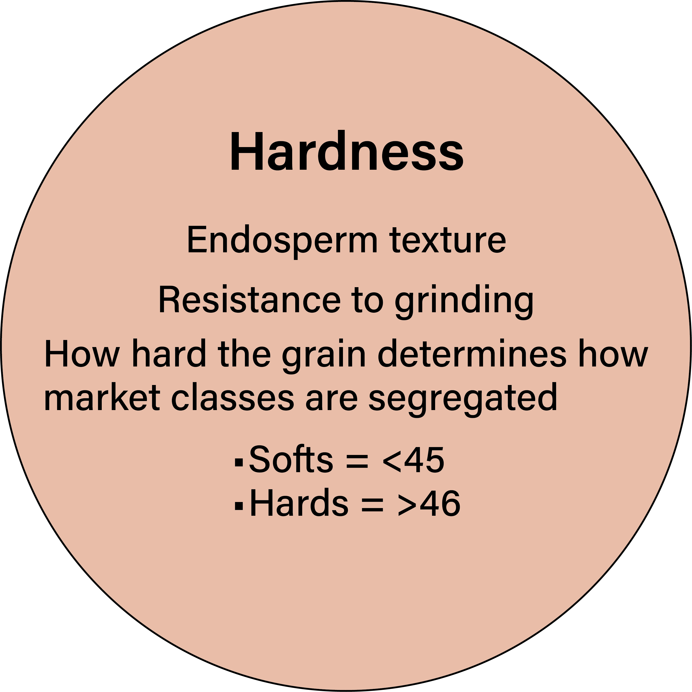{.toggle-img .nolightbox #fig-hardness} 

::: {.toggle-text}  
Kernel hardness is the measurement of how hard a kernel of wheat grain resists grinding as well as a measurement of endosperm texture.  

**Single–Kernel Characterization System** (SKCS) instruments evaluate wheat kernel texture characteristics by measuring kernel weight, diameter, moisture content, and the force needed to crush the kernel. Harder kernels require greater force to crush than softer kernels.  

Market class is determined depending on where wheat falls on the hardness scale from 1-100. If hardness is below 45, it is categorized as a soft wheat. Anything above 45 would be categorized as a hard wheat.  

:::

:::

::: {.expand-box onclick="this.classList.toggle('active')" style="cursor: pointer;"}  
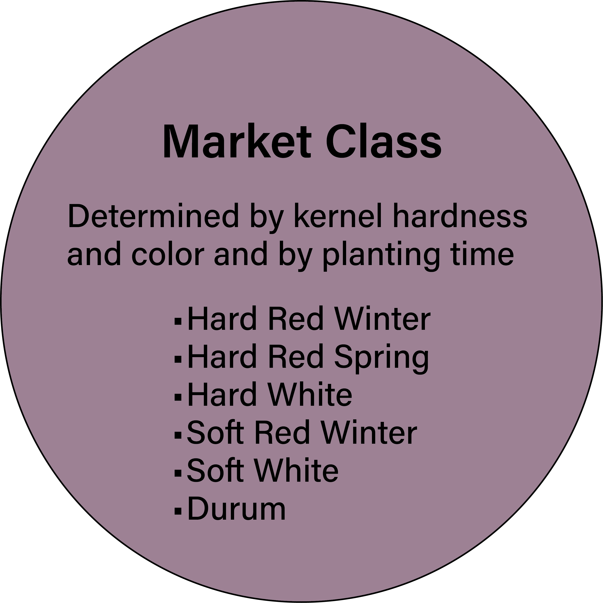{.toggle-img .nolightbox #fig-market-class}

::: {.toggle-text}
Wheat market class is determined by kernel hardness (hard or soft) and color (red or white) and then further categorized by planting season (winter or spring). There are six classes of wheat: Hard Red Winter, Hard Red Spring, Hard White, Soft Red Winter, Soft White, and Durum. Each class of wheat has its own characteristics related to milling, baking, and end-use. The PNW region grows all but one class, Soft Red Winters.  

See @sec-classes for further information on classes.  

:::

:::

::: {.expand-box onclick="this.classList.toggle('active')" style="cursor: pointer;"}
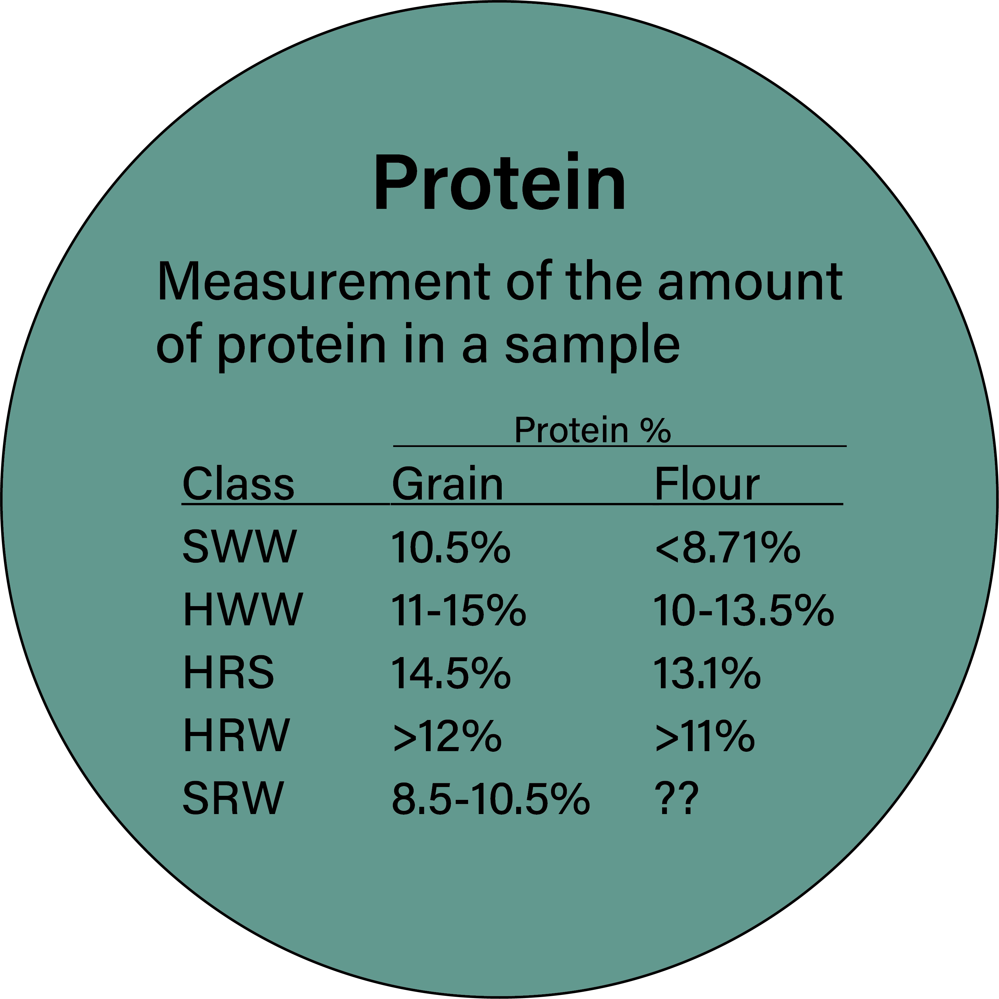{.toggle-img .nolightbox #fig-protein}

::: {.toggle-text}  
Protein amount is likely the most well-known quantifier of wheat quality although it is an imprecise predictor of processing performance. The protein content and composition in wheat can vary depending on class, growing conditions, and fertilizer inputs especially nitrogen and sulfur.  

Applications of nitrogen fertilizer have been documented to have a strong impact on wheat protein content. However, higher levels of N in a variety with a poor protein quality will give only a very restricted improvement in baking quality *(WHEAT: Chemistry and Technology, Fourth Edition)*.  

For end-use purposes, higher protein content usually requires more water for product input and a longer mixing time to achieve optimum dough consistency. Protein content and composition can be correlated to end-use attributes, such as texture and appearance. It is the quality of the gluten protein (highly driven by genetics) *(source: Association Between Allelic Variation at the Combined Gli-1, Glu-3 Loci and Protein Quality in Common Wheat (*Triticum aestivum L.*)*) within a wheat variety that determines good or poor baking properties at a given protein content.  

::: {#tbl-protein-targets}

| Class     | Usage                           | Protein |
|-----------|:--------------------------------|--------:|
|Soft flour | cakes and pastries              | 7-11%   |  
|Hard flour | pan breads and specialty breads | >12%    |

: Protein targets and production usage for hard and soft wheat flours
:::

::: {.callout-tip} 
##### Testing for Protein Content  

**Combustion Nitrogen Analyses (CNA):** Since protein is the major wheat compound that contains nitrogen, the protein content can be determined by measuring the amount of nitrogen released during high temperature burning. Results are expressed as a percentage of the total sample weight. CNA is often used to develop calibrations for other protein methods, such as Near Infrared Transmittance (NIRT) or Near Infrared Reflectance (NIRR).  
:::  

:::

:::

::: {.expand-box onclick="this.classList.toggle('active')" style="cursor: pointer;"}
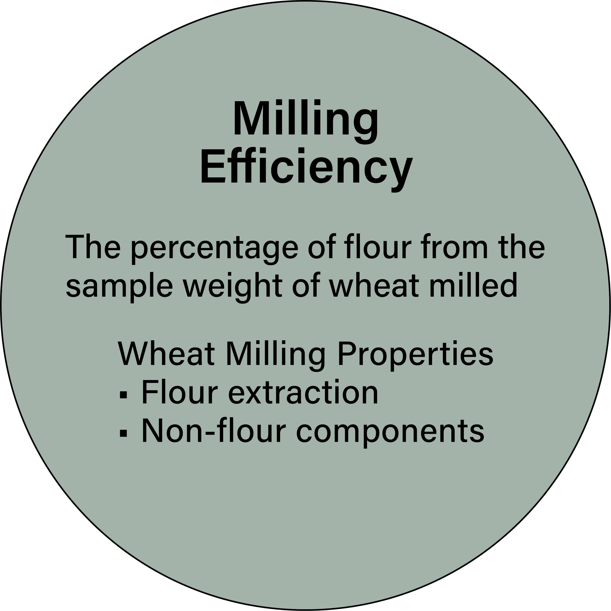{.toggle-img .nolightbox #fig-milling}

::: {.toggle-text}  
Key milling parameters include **overall flour yield**--the percentage of total flour obtained from the input of wheat berries--**break flour yield**, which represents the percentage of flour produced from the first break roll, **flour ash content** (the non-organic mineral components within the flour), flour color, and particle-size distribution. These parameters form the foundation of milling performance and allow for comparisons across cultivars or blends.  

Desirable targets for flour yield percentage are greater than 60% for HW and greater than 68% for all other classes.  

Grain hardness is a critical quality trait influencing wheat’s milling properties (Miller et al., 1982; Finney et al., 1987). It is the main criteria for the separation of soft and hard classes and is associated with the water absorption capacity of flour or semolina and the baking quality of the resulting dough. Additionally, grain hardness affects milling duration, energy requirements, and the degree of starch damage in the milled flour (R. J. Peña et al.).  

::: {.callout-tip}  
##### Testing Milling Efficiency  

Laboratory wheat milling tests are conducted to indicate milling properties on small amounts of wheat samples. Commercial mills can use this information to adjust mill settings and optimize flour extraction. Using a small sample of cleaned wheat, grain moisture content is determined and water is added 8-12 hours before milling to soften (temper) the grain. The grain is tempered to allow the bran to separate from the endosperm more easily in large pieces with a more leathery texture. Grain that has not been tempered will be more brittle and there will be more bran shattering and thus more bran contamination in the refined flour. The tempered wheat is then run through a micro-mill and mill fractions (flour streams, bran, shorts, etc) are measured by weight to calculate percentages of wheat milling efficiency.  

For soft wheat flour, a higher break flour yield is desired, with the target percentage for the Pacific Northwest (PNW) region being greater than 46.75%. For hard wheat flour, total flour yield is the most critical parameter: hard white wheat must achieve a minimum yield of 70%, while hard red wheat must reach at least 67%.  

:::

:::

:::

:::  
<!--End gallery-->

::: {.callout-tip icon=true collapse=false}
#### Learn more about wheat and flour testing methods  

[Wheat and Flour Testing Methods](https://www.uswheat.org/wp-content/uploads/2021/07/Wheat-and-Flour-Testing-Methods-Book.pdf)  
[Wheat and Flour Testing Methods: A Guide to Understanding Wheat and Flour Quality: Version 2](https://www.grains.k-state.edu/igp/wheat-flour-testing/wheatflourbook/wheat-flour-book.pdf)  

:::

::: {#fig-brabender layout-ncol=2}

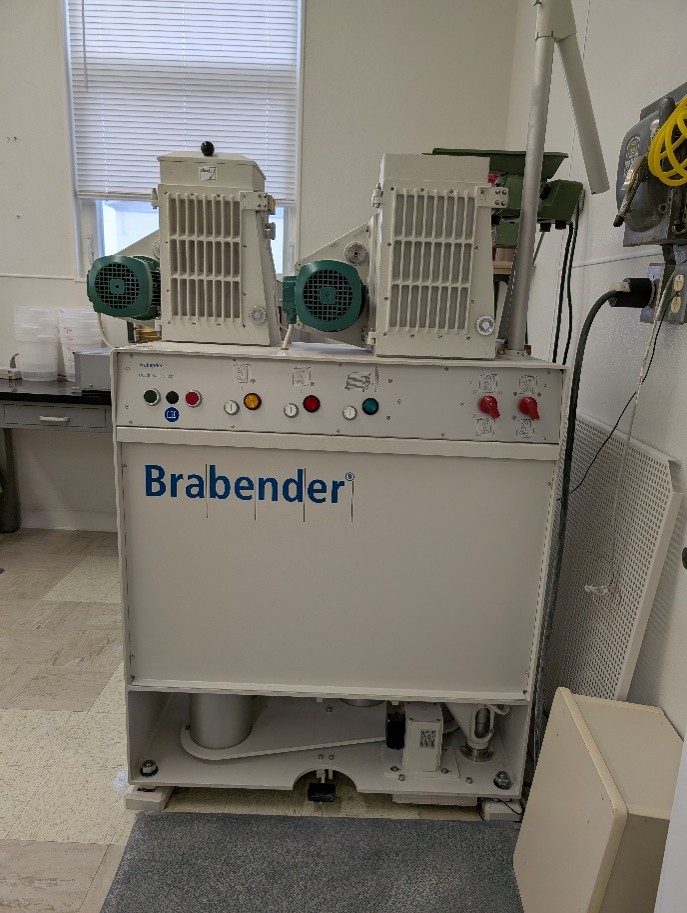{group="brabender"}

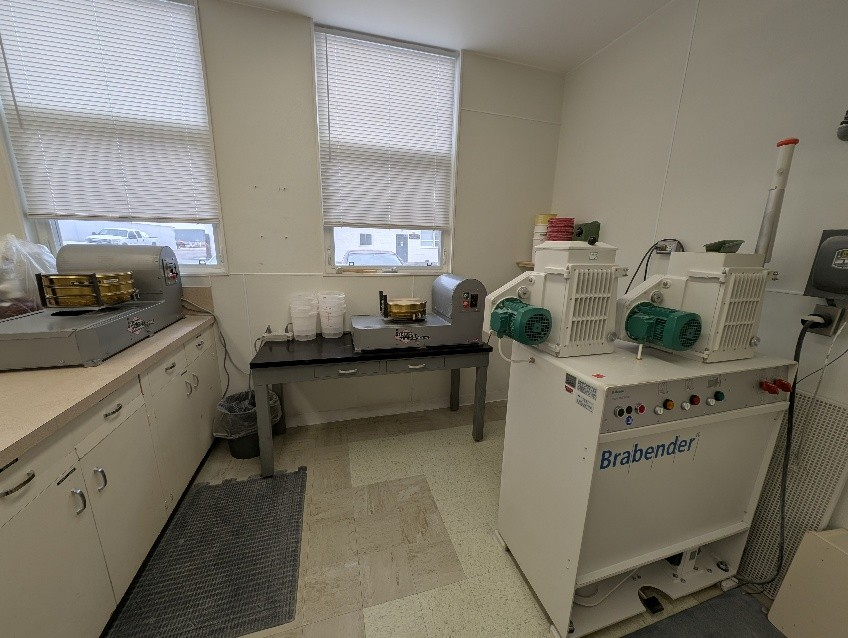{group="brabender"}

Example of a micro-milling laboratory setup. Shown, is a Brabender Quad. Sr. which has a double pass grinding flow that uses a series of three rolls to grind the wheat sample.  

:::

### Additional Flour Components

::: {.border} 

:::

#### [Moisture]{.underline}

All flour should have moisture content of less than 14% to maintain storage stability (primarily to restrict mold growth) and to ensure that flour flows without caking or clumping during transfer in mills and bakeries (Atwell 2001). The percentage of water inherently present within the flour is a vital part of necessary calculations for further quality testing. Depending on the moisture level of the flour, variations of solvents for testing or baking can be adjusted for optimal performance.\  

#### [Ash]{.underline} 

Ash content is the inorganic mineral residue remaining after complete combustion of flour and is reported as % on a dry basis. Because minerals are concentrated in the bran and aleurone layers, ash increases with milling extraction; thus, ash serves both as an index of expected milling yield and as a diagnostic of bran carryover (bran contamination) into the flour stream. Higher ash generally correlates with reduced flour brightness and produces darker crumb and crust in finished products. Accordingly, product specifications are aligned with intended functionality: highly refined (patent) white flours target low ash, whereas high‑extraction and whole‑wheat flours require and tolerate higher ash.\ 

### The Fundamentals of Soft Wheat

Wheats with hardness values <45 are distributed in the classes of Soft Red Winter and Soft White Winter. They are physically softer and require less energy input to separate bran from the starchy endosperm, leading to less starch damage and less ash content. Soft wheats have a lower protein target range for both wheat and flour and break flour yield is the first consideration when evaluating milling efficiency.

### Testing End-Use Quality for Soft Wheat
::: {.border} 

:::

#### [Sugar Snap Cookies]{.underline} 

The **Sugar‑Snap Cookie test** assesses soft wheat flour suitability for cakes, pastries, cookies, crackers, and Asian‑style noodles. Flours with low protein and weak gluten typically produce high‑spread cookies with extensive surface cracking, signaling desirable performance characteristics associated with favorable processing and product quality for these end uses. 

Typically, cookie and cracker products are baked to a very low moisture which requires time and energy. Low hardness and high break flour in the milling process produces flour with lower damaged starches which lower absorption of water in dough. This allows for less time and energy to bake and creates better cookies or crackers that bake uniformly, spreads predictably, and can fit within the desired packaging.

::: {style="float: left; margin-right: 15px; margin-bottom: 10px;"}

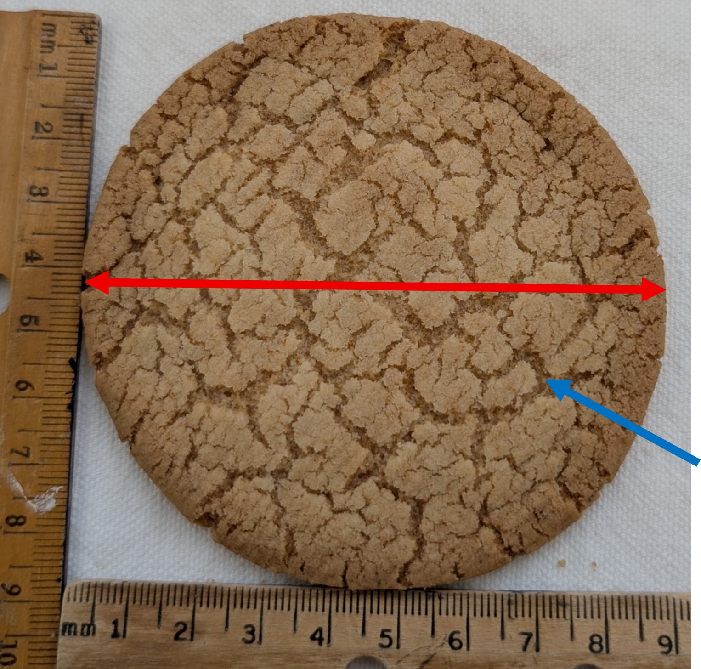{fig-alt="Sugar snap cookie with perpendicular rulers, measuring cookie spread and top grain" width="350px"} 

::: 

Cookies are evaluated for cookie spread (diameter) and top grain appearance.\  

Cookie spread is measured and the results are expressed in centimeters.\  

Extra consideration:\  
Top grain is evaluated by visual examination of the pattern of cracks and “islands” on the top surface of the cookie and a numerical score is given (0 to 9 for least to most desirable). Top grain is not considered as an approved AACC method. Some quality labs will use this extra criterion, while most will not due to the subjective nature of the method.\ 

When any one of the four fundamental units of quality are outside of the desired range for end-use production, it can introduce a cascade of undesirable effects on product line and product performance as well as increase production waste.\ 

![The cookies pictured above compare least desirable outcomes (left) and most desirable outcomes (right) for end-use quality. The left cookie is pale, has very little spread, and no top grain. This indicates that the sample was likely a hard wheat with high hardness as well as a higher protein in both grain and flour. In comparison, the right cookie has a large spread, golden brown color, and numerous, evenly spaced top grain. The right cookie was a SWW with low hardness, low protein, and good milling performance.](figs/19-4-cookies-ld-md.jpg){#fig-cookies-ld-md .img-wpg}

::: {style="float: left; margin-right: 15px; margin-bottom: 10px;"}

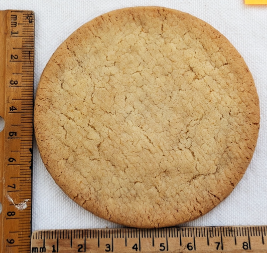{#fig-cookie2 width="350px"} 
:::

The cookie in @fig-cookie2 is also a SWW. However, though the cookie had some spread and some top grain, there was not as much as desired. The wheat this flour came from had a higher grain protein (and a higher flour protein) than the required target range for SWW.\ 

#### [Japanese Sponge Cakes]{.underline} 

Sponge cake is a prevalent Asian dessert and a benchmark product for evaluating weak‑gluten soft wheat flour utilized in diverse confectionery items. The sponge cake test is employed to assess flour suitability for these applications. Optimal product performance is typically achieved with flours exhibiting low protein content, low ash levels, and weak gluten characteristics.\ 

#### [Alkaline Asian Noodle Color Analysis]{.underline}

Asian noodles are produced from both soft and hard wheat, yet all styles share a core requirement: an attractive visual appearance. Among appearance attributes, color is paramount because it is the first visual attribute perceived by consumers. Typical noodle color ranges from bright or creamy white to pale or vivid yellow.\ 

Discoloration most often arises from the presence of bran particles in the flour and becomes more pronounced as flour extraction increases. High levels of polyphenol oxidase (PPO), concentrated largely in the bran, cause progressive darkening of noodle dough through an oxidation reaction similar to the browning of cut apples. This darkening is especially problematic when processors rest dough, to improve handling or the eating quality of boiled noodles, as excessive color change shortens the allowable rest time. Additionally, for fresh noodles, the period during which the product maintains its desired appearance is greatly decreased.\

Polyphenol oxidase (PPO) activity in bran is genetically determined and can be reduced through breeding of wheat lines targeted for Asian noodle applications. Ash content also contributes to discoloration; consequently, noodle manufacturers prefer flours milled from wheats with strong milling performance that enable clean separation of bran from the starchy endosperm.\

#### [Testing Sheet Noodle Color]{.underline}

A sample of three Asian noodle dough sheets are cut and stacked together. Measurements are taken with the Minolta chroma meter, and an average L\* (white/black), a\* (red/green), and b\* (yellow/blue) are recorded. Two readings are taken at 0 and 24 hours and the differences in L\*, a\*, and b\* are calculated. The desirable target for the difference in color should be below 10.\ 

{#fig-noodle .img-wpg}  

### The Fundamentals for Hard Wheat

Wheat with hardness values >45 have the market classification of Hard Red Winter, Hard Red Spring, Hard White, or Durum. Hard wheats are physically harder to mill, which increases starch damage and ash content, and target ranges for wheat and flour protein are higher. Hard wheat total flour yield is the first parameter considered for milling quality.\ 

### Testing End-Use Quality for Hard Wheat

::: {.border}

:::

#### [Mixograph]{.underline}

Performing a mixograph for a wheat sample quickly analyzes small quantities of flour for dough gluten strength, which include:\ 

**Water absorption**: The amount of water added into the dough; affects the position of the curve on the graph paper; less water increases dough consistency and moves the curve upward.\ 

**Peak time**: the timing when the sample of reaches peak gluten strength; measured in minutes\ 

**Mixing tolerance**: tolerance to over-mixing; gluten strength decreases after reaching its peak; tolerance is the slope of the descending line\ 

::: {#fig-mixograph .img-wpg layout-nrow=2}

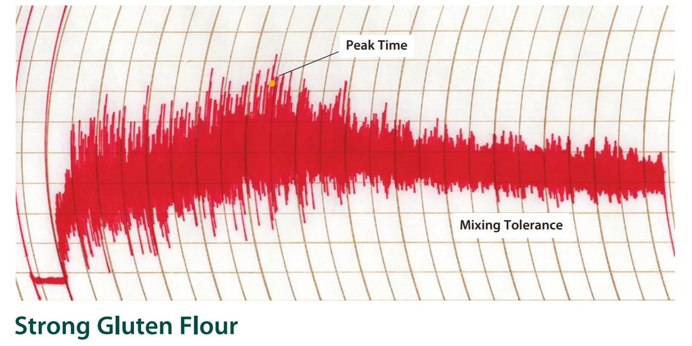{width=100%}

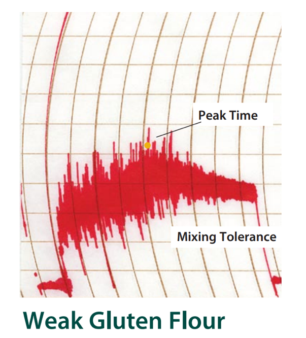{width=50% fig-align="left" fig-cap-location="right"}  
Source: Wheat and Flour Testing Methods: A Guide to Understanding Wheat and Flour Quality: Version 2

::: 

#### [Farinograph]{.underline}

The farinograph measures dough resistance to paddle mixing, yielding metrics such as absorption, development (arrival) time, stability, peak, departure, and MTI. Processors use these parameters to set water levels, evaluate ingredient impacts, determine blending requirements, and monitor flour uniformity. The profile further predicts processing needs such as mixing time, over‑mixing tolerance, and production consistency as well as provides guidance on expected texture, with stronger mixing properties typically producing firmer products.\

**Absorption**: amount of water required to center the farinograph curve on the 500-Brabender unit (BU) line. This relates to the amount of water needed for a flour to be optimally processed into end products. Given as a percentage.\

**Peak Time**: indicates dough development time, beginning the moment water is added until the dough reaches maximum consistency. This gives an indication of optimum mixing time under standardized conditions. Expressed in minutes.\

**Arrival Time**: is the time when the top of the curve touches the 500-BU line. This indicates the rate of flour hydration (the rate at which the water is taken up by the flour). Expressed in minutes.\

**Departure Time**: the time when the top of the curve leaves the 500-BU line This indicates the time when the dough is beginning to break down and is an indication of dough consistency during processing. Expressed in minutes.\

**Stability Time**: is the difference in time between arrival time and departure time. This indicates the time the dough maintains maximum consistency and is a good indication of dough strength. Expressed in minutes.\

**Mixing Tolerance Index (MTI)**: is the difference in BU value at the top of the curve at peak time and the value at the top of the curve 5 minutes after the peak. This indicates the degree of softening during mixing. Mixing tolerance index is expressed in Brabender units (BU).\ 

::: {#fig-farino .img-wpg layout-nrow=2}

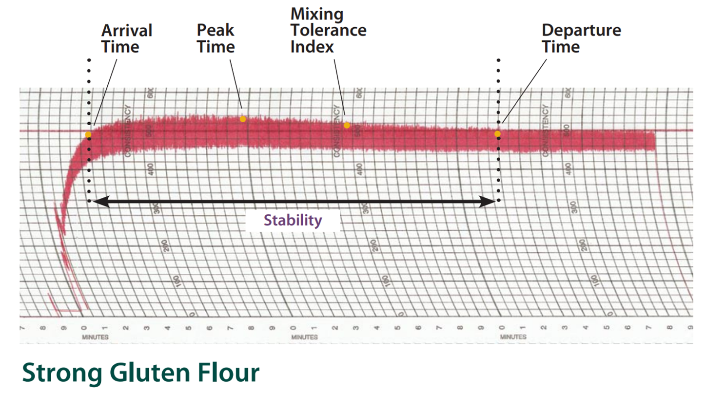{width=100%}  

{width=50% fig-align="left" fig-cap-location="right"}  

Source: Wheat and Flour Testing Methods: A Guide to Understanding Wheat and Flour Quality: Version 2  

:::

### Bread Quality Tests

Bread‑making performance is governed by the quantity and quality of gluten. Gluten quality is mainly influenced by genetics with minimal influence from growing environment or fertilization. In general, higher protein improves baking performance (especially loaf volume) when gluten is strong, but additional nitrogen field input provides little benefit in cultivars with inherently weak gluten. For bread end-use purposes, optimal dough exhibits balanced viscoelasticity: strong enough to withstand mixing and handling and to retain fermentation gases, yet sufficiently extensible to expand and form an open, aerated crumb.\ 

During milling, hard wheats typically sustain more damaged starch than soft wheats. In bread, this damage contributes to a soft, pleasant crumb and slows staling. Flours with good bread‑making characteristics therefore require some damaged starch which 1) absorbs water rapidly and in greater amounts than intact starch; and 2) enables amylolytic enzymes to produce maltose and dextrins that support fermentation and crumb structure.\ 

#### [Pan Bread Bake Quality Test]{.underline}

Pan‑bread quality is assessed using a standardized scoring system relative to a control, covering dough handling, finished‑loaf metrics, and sensory attributes. During processing, dough is evaluated for strength, extensibility, and stickiness. Baked loaves are measured for weight (g) and volume (cm³), from which specific volume (cm³/g) is calculated. Exterior appearance, crumb‑grain uniformity, and texture are then scored to generate an overall quality index. Together, these measures characterize flour performance and lot‑to‑lot consistency, enabling bakers—particularly in high‑speed operations—to select flours that deliver reliable volume, color, and texture aligned with consumer expectations.\ 

::: {#fig-pan-bread layout-ncol=2}

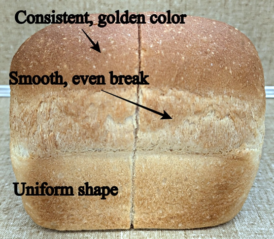{fig-align="right" width="250px"}

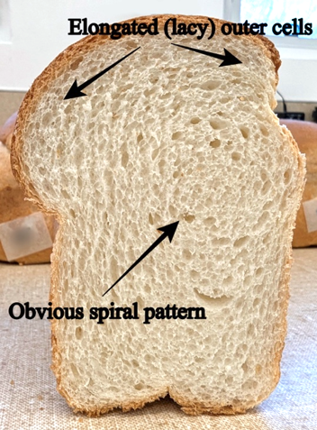{fig-align="left" width="250px"}

:::

#### [Hearth Bread Bake Quality Test]{.underline}

The hearth bread test is a small-scale baking evaluation used to optimize processing conditions prior to commercial production. It assesses dough strength and extensibility, then measures loaf weight (g) and volume (cm³) to calculate specific volume (volume/weight). Finished loaves are scored against a control for processing behavior, appearance, crust and crumb characteristics, and texture. Hearth breads typically have thicker/crisper crusts than lidded pan breads and can exhibit crumb structures ranging from fine and uniform to open and irregular.\ 

For assessing breadmaking suitability of breeder lines or grain lots, key indicators include dough rheology, loaf volume (a strong overall index), form ratio (height-to-width), crumb cell uniformity/size/shape/wall thickness, and texture attributes such as moistness, elasticity, and smoothness.\ 

### Wheat Flour Chemistry Quality Tests

#### Sedimentation Test

::: {style="float: right; margin-left: 15px; margin-bottom: 10px;"}

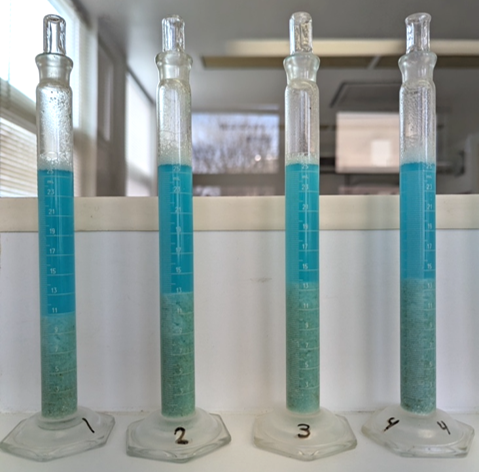{width=40% display="inline" fig-align="left"} 

:::

The sedimentation test is performed by suspending a ground wheat or flour sample in an acidic solution and allowing the gluten proteins to hydrate, swell, and settle as a precipitated sediment. Sedimentation values typically range from ~20 or lower for low-protein wheat with weak gluten to ~70 or higher for high-protein wheat with strong gluten. The test provides an index of both protein quantity and protein quality in wheat and flour. Sedimentation volume is generally positively correlated with gluten strength and, in many cases, loaf volume. As a result, the sedimentation test is commonly used as a rapid screening method in wheat breeding programs and as a practical quality assessment tool in milling applications.\ 

#### SRC (Solvent Retention Capacity) Tests

Four solvents are individually mixed with a sample of flour: deionized water, 50 percent sucrose, 5 percent sodium carbonate, and 5 percent lactic acid. Solvent retention capacity (SRC) is the weight of solvent held by flour after centrifuging.\ 

Individual SRC solvents are associated with distinct flour constituents:\ 

::: {.indent-border}
 * Lactic acid SRC: gluten protein functionality 
 * Sodium carbonate SRC: damaged starch levels which occur during milling
 * Sucrose SRC: pentosan (arabinoxylan) content 
 * Water SRC: represents the combined contribution of all water-absorbing components 
 
:::

::: {#tbl-panel layout-nrow=2}

|           | Water               | Carbonate        | Sucrose                | LA        |
|-----------|---------------------|------------------|------------------------|-----------|
|           | <58                 |       <75        | <95                    | 60-170    |
| Indicates | absorption capacity | damaged starches | pentosans and gliadins | glutenins |
| Product influence |             | cookie spread    | negatively correlated with cookie diameter | elasticity + extensibility |

: Soft Wheat Flour {#tbl-soft}

|           | Water               | Carbonate        | Sucrose                | LA        |
|-----------|---------------------|------------------|------------------------|-----------|
|           |         65-70       |     105-115      |         80-90          |   >140    |
| Indicates | absorption capacity | damaged starches | pentosans and gliadins | glutenins |
| Product influence |             | bread staling    | water retention | positively correlated with loaf volume |

: Hard Wheat Flour {#tbl-hard}

Interpreted together, the SRC profile provides a practical measure of flour quality and functionality and is useful for predicting baking performance.

:::

#### Rapid Visco Analyzer (RVA)

The Rapid Visco Analysis (RVA) test evaluates starch viscosity by heating a starch- or flour–water slurry under standardized conditions while continuously measuring the resistance experienced by a rotating sensor. The instrument records this resistance electronically and generates a viscosity profile, typically reported as apparent viscosity versus time, which reflects key flour starch functional properties.\ 

For Asian noodle applications, flours exhibiting medium to high peak viscosity are generally preferred because they are associated with improved noodle texture. In addition, the RVA can be used to determine a stirring number, a metric linked to sprout damage. The stirring number provides an indirect assessment of elevated enzyme activity—particularly alpha-amylase—caused by pre-harvest sprouting. Sprout-damaged wheat often produces flour that yields sticky, difficult-to-handle dough and can lead to finished products with reduced color quality and weaker texture.\ 

## Markets and transportation - domestic and export
*Coming soon!*

