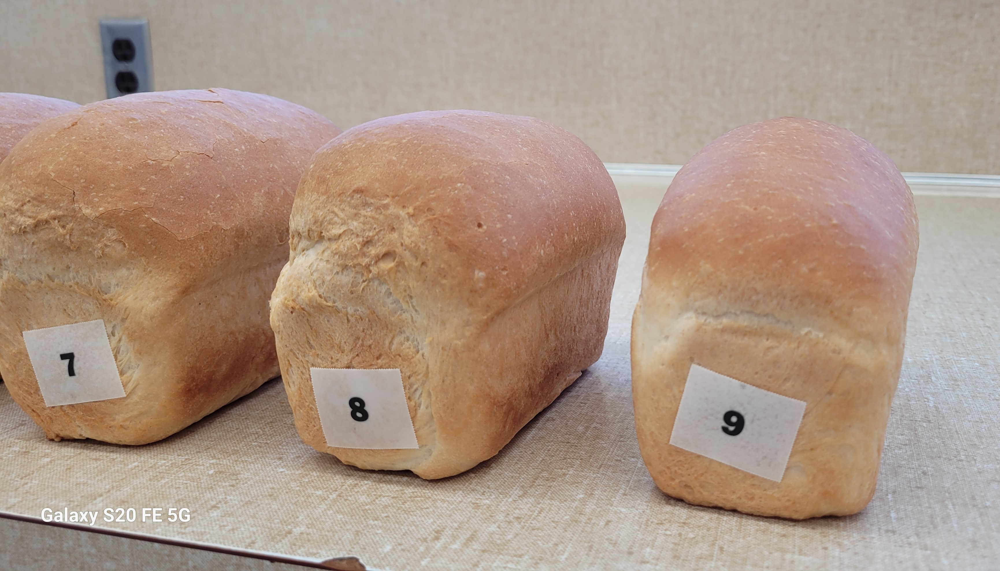
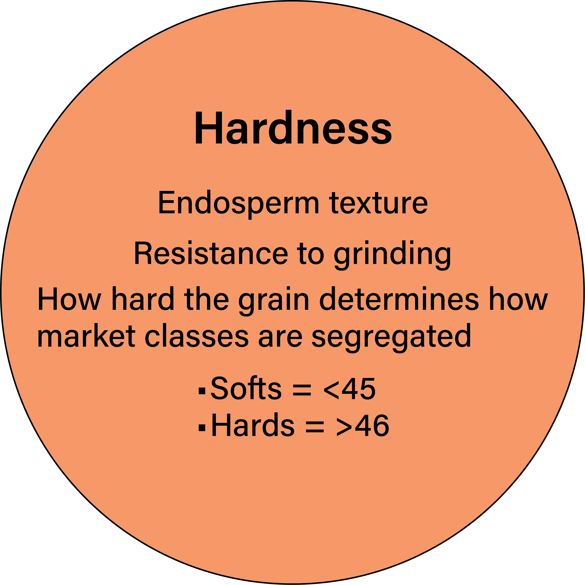
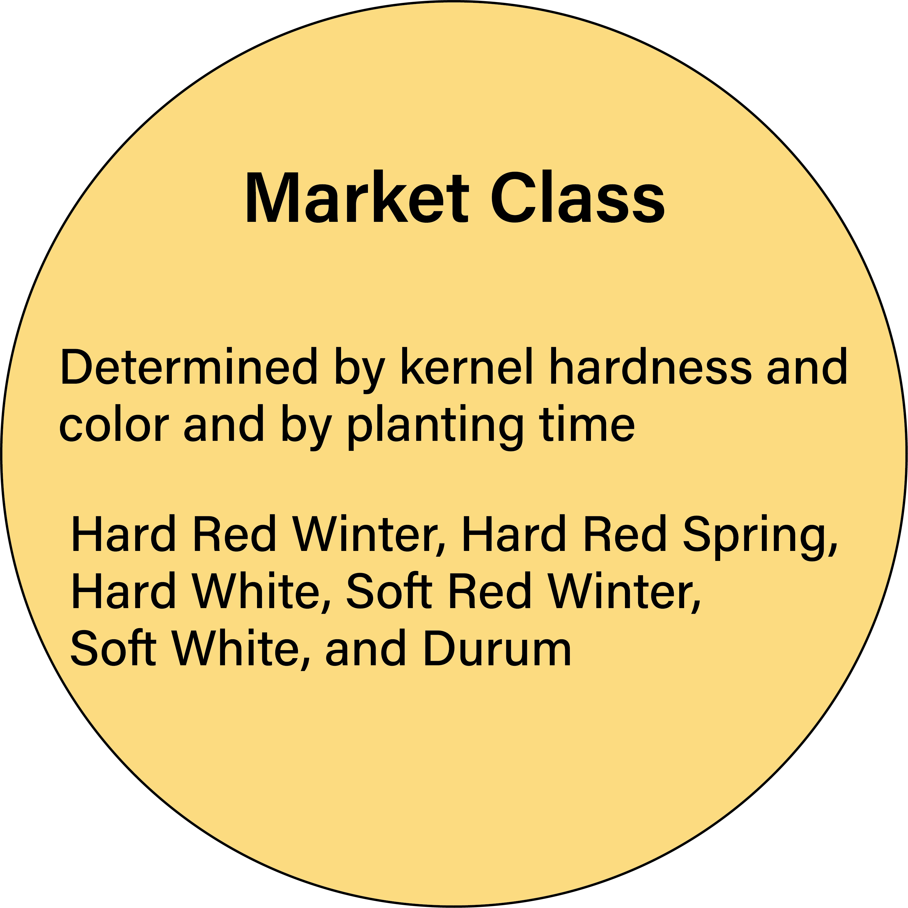

*Image: J Piaskowski*

## Introduction

Wheat is not a uniform commodity. It is a raw material for a wide range of foods and industrial products used worldwide. This reality underscores a core principle: quality is paramount. When millers, bakers, or other end users encounter processing difficulties, the value of a lot declines. The following sections summarize the factors that create quality variation—what makes grain more or less valuable.  

Different end products demand flours with specific functional properties to meet processing and finished product targets. Suitability is largely determined by:  

*	Kernel texture (hardness)  
*	Starch characteristics  
*	Gluten composition, which governs dough strength, extensibility, and handling  

Matching a wheat variety to its appropriate end-use product begins with assessing composition and milling potential. Routine tests quantify moisture, protein, kernel texture, grain soundness, ash, and related components. Composition provides a first approximation of processing potential.  

More reliable prediction requires tools that measure or model the functional behavior of flour, dough, or key constituents (e.g., gluten, starch, arabinoxylans). Common approaches include:  

*	Starch and flour pasting properties  
*	Solvent Retention Capacity (SRC)  
*	Dough testing and rheological prediction of dough properties  

In the Idaho and Pacific Northwest, soft white wheat is primarily used for cookies, crackers, cakes, batters and breadings, and selected noodle types. Hard red spring and hard red winter wheats are preferred for tortillas, yeast leavened pan and hearth breads, and yellow alkaline noodles requiring stronger gluten. Across these applications, regional wheats are noted for efficient milling, producing bright, low ash flours with high extraction rates and consistent baking performance.  

Wheat quality is genetically complex. Breeders, in close collaboration with cereal chemists, are responsible for ensuring new varieties meet milling and baking requirements. Varieties are developed to align with established market classes and grades, supporting predictable performance from field to finished product.  

By aligning production with end use specifications and delivering clean, sound grain, Idaho and PNW growers ensure the value of their crop, strengthen buyer confidence, and sustain the region’s reputation for high-quality flours with reliable end-use performance.  

## Classes and grading {#sec-classes-and-grading}

### The U.S. System of Classes

The U.S. system of marketing wheat relies on statutory standards set out by Congress and administered by the Federal Grain Inspection Service (FGIS) in the Grain Inspection, Packers, and Stockyards Administration (GIPSA) of the U.S. Department of Agriculture and its approved state inspection agencies. The standards define wheat classes and set out the rules for determining grades within classes. The standards have evolved over time to reflect important issues and concerns of the marketplace.  

The official standards currently list the following eight classes and subclasses of wheat:  

1. **Durum wheat.** All varieties of white (amber) durum wheat. This class is divided into the following three subclasses:  

   i) Hard Amber Durum wheat. Durum wheat with 75 percent or more of hard and vitreous kernels of amber color.  
  
   ii) Amber Durum wheat. Durum wheat with 60 percent or more but less than 75 percent of hard and vitreous kernels of amber color.  
  
   iii)	Durum wheat. Durum wheat with less than 60 percent of hard and vitreous kernels of amber color.  
  
2. **Hard Red Spring wheat.** All varieties of Hard Red Spring wheat. This class shall be divided into the following three subclasses:  

   i)	Dark Northern Spring wheat. Hard Red Spring wheat with 75 percent or more of dark, hard, and vitreous kernels.  
  
   ii) Northern Spring wheat. Hard Red Spring wheat with 25 percent or more but less than 75 percent of dark, hard, and vitreous kernels.  
  
   iii) Red Spring wheat. Hard Red Spring wheat with less than 25 percent of dark, hard, and vitreous kernels.  
  
3. **Hard Red Winter wheat.** All varieties of Hard Red Winter wheat. There are no subclasses in this class.  

4. **Soft Red Winter wheat.** All varieties of Soft Red Winter wheat. There are no subclasses in this class.  

5. **Hard White wheat.** All hard endosperm white wheat varieties. There are no subclasses in this class.

6. **Soft White wheat.** All soft endosperm white wheat varieties. This class is divided into the following three subclasses:  

   i) Soft White wheat. Soft endosperm white wheat varieties which contain not more than 10 percent of white club wheat.  
  
   ii) White Club wheat. Soft endosperm white club wheat varieties containing not more than 10 percent of other soft white wheats.  
  
   iii) Western White wheat. Soft White wheat containing more than 10 percent of white club wheat and more than 10 percent of other soft white wheats.  
  
7. **Unclassed wheat.** Any variety of wheat that is not classifiable under other criteria provided in the wheat standards. There are no subclasses in this class. This class includes any wheat which is other than red or white in color.  

8. **Mixed wheat.** Any mixture of wheat that consists of less than 90 percent of one class and more than 10 percent of one other class, or a combination of classes that meet the definition of wheat.

{#fig-classes-map}

### The U.S. System of Grades

In addition to class and subclass, individual lots of wheat receive a **grade**. Grades aim to describe in general terms the relative quality of different grain lots within a market class. As such, grade-determining factors largely reflect aspects of a grain lot that would pose a processing problem or advantage, or a potential health or sanitation concern. 

@tbl-grades lists the current grade-determining factors for wheat; a brief explanation of each and why it is important follows. Before the grade-determining factors are measured, dockage is removed. Dockage is mostly non-wheat material that can be easily removed by sieving and is separated using the Carter Dockage Tester. Dockage also includes underdeveloped, shriveled, and broken kernels that cannot be easily recovered from the separated portion. Dockage, foreign material, and shrunken and broken kernels, besides being costly to separate, represent non-millable material. Any value associated with this material often depends on the availability of pelletizing equipment and the proximity of feed markets.  

It must be emphasized that although limits for damaged kernels, foreign material, and shrunken and broken kernels are set by the standards that determine official grade, customers may specify tighter limits. Also, although dockage is not a grade-determining factor, many of our "cash" customers overseas are setting tighter limits in their contract specifications. For example, contracts may specify maximum dockage in the range of 0.5 to 1 percent, but may further require that the dockage present be subtracted from the delivered weight.  

Increasingly, 2-to 3-fold discount penalties are applied for dockage levels above certain thresholds. Similarly, pressure continues to reduce levels of foreign material and shrunken and broken kernels. Recent analysis indicated that to be fully competitive with Australia and Canada, our industry would need to be able to consistently offer cleaned wheat with maximum 0.2 percent dockage, 0.2 percent foreign materials, and 0.7 percent shrunken and broken kernels. The message is clear: deliver cleaner wheat that is more nearly all convertible to flour. 

#### Wheat Grades and Grade Requirements

![(a) Grades and grade requirements for all classes of wheat, except Mixed wheat.  
(b) Grades and grade requirements for Mixed wheat. Mixed wheat is graded according to the U.S. numerical and U.S. Sample grade requirements of the class of wheat that predominates in the mixture, except that the factor wheat of other classes is disregarded.[^standards]](figs/19_1_us_wheat_standards.png){#tbl-grades width=100% .nolightbox}  

[^standards]: Table Source: [United States Standards for Wheat – Grades and grade requirements for wheat. 7 CFR 810.2204.](https://www.ams.usda.gov/sites/default/files/media/WheatStandards.pdf)  

#### Grade-Determining Factors

Expand grading factors below for a brief explanation of each and how it is used.  

::: {.wpg title="Test weight" collapse="true" icon="false"}

The purpose of test weight is to provide an estimate of the plumpness of the wheat kernel and therefore its potential for efficient milling into white flour of bright color and low ash content. Test weight also serves as a means of estimating the volume-bushel (weight) relationship in storage. Recently, there has been considerable controversy on this topic, however, especially among growers of soft red winter wheat.

:::

::: {.wpg title="Heat damaged kernels" collapse="true" icon="false"}

Heat damage reflects a prior history of adverse storage or handling conditions. Grain that was too wet in storage and thus suffered microbiological and physiological activity becomes heat damaged. For this reason, and the fact that heat damaged kernels cannot be readily cleaned out, fairly strict limits are set.

:::

::: {.wpg title="Damaged kernels (total)" collapse="true" icon="false"}

In addition to heat-damaged kernels, the Standards specify limits on "badly ground-damaged, badly weather-damaged, diseased, frost-damaged, germ-damaged, insect-bored, mold-damaged, sprout-damaged, or otherwise materially damaged" kernels. Percentages are determined on the basis of kernels, pieces of kernels, and other grains which remain after removing kernels in Dockage and Shrunken and Broken categories.\

Probably the most notorious of these for PNW growers is sprout damage. On a regular basis, sprout is not a serious regional problem. Occasionally, however, untimely rains delay harvest and may cause serious problems. The problem is exacerbated by the general lack of seed dormancy in our white wheat varieties and the relatively low tolerance of many soft white wheat end-products to $\alpha$-amylase - the main enzyme associated with sprout.

:::

::: {.wpg title="Foreign material" collapse="true" icon="false"}

Foreign material includes all matter other than wheat that remains in the sample after dockage and shrunken and broken kernels are removed. Since foreign material is not easily removed by sieving and, by definition, it is not wheat, it presents more of a problem to the flour miller. Added expense is incurred as more elaborate cleaning processes are employed to remove the material.

::: 

::: {.wpg title="Shrunken and broken" collapse="true" icon="false"}

Often referred to as "S & B", shrunken and broken refers to all material removed by sieving on a 0.064 x 3/8 inch oblong-hole sieve. S & B is determined after dockage is removed.

:::

::: {.wpg title="Defects (total)" collapse="true" icon="false"}

The sum of damaged kernels, foreign materials, and shrunken and broken cannot exceed the maximum limit set for each grade. For example, U.S. No. 1 Soft White Wheat may contain up to 2.0 percent total damaged kernels, 0.4 percent foreign material, or 3.0 percent shrunken and broken, but the total of the three cannot exceed 3.0 percent. Wheat that contained all three of these at the maximum level specified for U.S. No. 1 wheat would have 5.4 percent total defects and consequently would grade U.S. No. 3.

:::

::: {.wpg title="Wheat of other classes" collapse="true" icon="false"}

Wheat of other classes is divided into *Contrasting Classes* and *Wheat of Other Classes, Total*. The limits set for wheat of contrasting classes is more strict than for Wheat of Other Classes, reflecting the greater problem of having wheat with contrasting end-uses. For both Soft and Hard White wheats, the contrasting classes are Hard Red Spring, Hard Red Winter, Soft Red Winter, Durum, and Unclassed wheats. For Hard Red Spring and Hard Red Winter wheats, contrasting classes are Durum, Hard White, Soft White, and Unclassed wheats.

:::

::: {.wpg title="Special grades and classifications" collapse="true" icon="false"}

Special grades and classifications relate to certain specific problems or contaminants in a grain lot. They include such things as ergotty wheat, light smutty wheat, and smutty wheat. For more information on the special grades, refer to the official standards.

:::

### Learn more about wheat grading and classes:

[Working with Buyers: Wheat Classes - US Wheat](https://www.uswheat.org/working-with-buyers/wheat-classes/)  

[Working with Buyers: Wheat Grades and Grade Requirements - US Wheat](https://www.uswheat.org/working-with-buyers/wheat-grade-factors/)  

[Grain Grading Primer - USDA-ARS/FGIS](https://www.ams.usda.gov/sites/default/files/media/GrainGradingPrimer11272017.pdf)  

[Market Information - US Wheat](https://uswheat.org/market-information/)  

## Falling number

**Alpha-amylase** is a naturally occurring enzyme in wheat kernels that breaks down complex starch molecules into simple sugars, which provide an energy source for the germinating seed. Although this process is essential for sprouting, the production of high-quality wheat flour and wheat-based products depends on the presence of intact starch granules. Excessive alpha-amylase activity can degrade these starches and negatively affect flour functionality and end-product performance.\

The **Falling Number test** is used to assess the level of starch degradation caused by alpha-amylase activity in wheat meal or flour. During the test, a measured quantity of ground wheat or flour is combined with distilled water in a glass tube containing a stirrer and mixed to create a slurry. The tube is then placed in a boiling water bath while the sample is continuously stirred. As the mixture heats, the starch gelatinizes and forms a viscous paste.\

The Falling Number instrument evaluates the **viscosity** of this paste by measuring the time required for a standardized stirrer to descend through the sample. Results are reported as a Falling Number value in seconds and serve as an indicator of alpha-amylase activity. 

* Higher Falling Number values, typically **above 300 seconds**, indicate low enzyme activity and sound wheat or flour quality.  
    
* Lower values, generally **below 250 seconds**, indicate elevated enzyme activity and are commonly associated with sprout-damaged wheat or flour.\

For many wheat markets, particularly those serving international export channels, only grain lots with Falling Number values of **300 seconds or greater are accepted**. In the Pacific Northwest (PNW) region of the United States, soft white wheat is the predominant class produced. Market contract specifications for both soft white and western white wheat generally require a Falling Number of at least 300 seconds. Grain lots falling below this threshold are typically subject to price discounts, regardless of their actual impact on end-product quality.\

### Causes of Low Falling Number

Low Falling Number (LFN) can negatively affect wheat quality and market value. In the Pacific Northwest, four primary factors contribute to low Falling Number values:\

*	**Green Kernels:** Immature kernels can substantially reduce Falling Number, even when present in small amounts. Harvesting at full maturity is the most effective prevention strategy.\

*	**Preharvest Sprouting (PHS):** Moisture exposure after grain maturity can initiate sprouting, increasing alpha-amylase activity and lowering Falling Number. Tolerant varieties provide the best protection against PHS.\

*	**Late-Maturity Alpha-Amylase (LMA):** Cool temperatures during the soft dough stage can trigger elevated alpha-amylase activity without visible kernel damage. Growing tolerant varieties and, when conditions allow, delaying harvest may help mitigate impacts.\

*	**Non-Alpha-Amylase Induced Low Falling Number (NAIL):** Environmental stress during early grain development can result in low Falling Number without increased alpha-amylase activity. Affected grain often has low protein content. Variety selection and, in some cases, post-harvest blending can help manage NAIL-affected grain.\

Understanding the cause of low Falling Number is critical for selecting appropriate management practices and minimizing economic losses.\

### Disease Pressure Resulting in Low Falling Numbers

### Impacts of LFN on End-Use Products

The level of enzyme activity measured by the Falling Number test indicates wheat flour functionality and end-product quality. Excessive alpha-amylase activity breaks down starch into simple sugars, resulting in reduced starch content and an excess of sugars. Because starch provides the structural framework in products such as bread, cakes, cookies, and noodles, excessive enzyme activity can negatively affect both processing and product performance.\

Wheat flour with high alpha-amylase activity often produces sticky doughs, thin batters, reduced loaf volume, and undesirable texture characteristics in finished products. During processing, affected doughs may become difficult to handle due to increased stickiness and tackiness.\

While wheat flour with very high Falling Number values (indicating low enzyme activity) can often be corrected by adding enzymes during milling or baking, when Falling Number values are too low, the excess alpha-amylase cannot be removed from the wheat or flour. As a result, severely affected grain may have limited marketability and may be unsuitable for many end-use applications.\

{#fig-fn-bread}  
  
  

{#fig-fn-cake}  
  
  
::: {.callout-tip collapse="false" icon="true"}

### Suggestions for Reducing Risk of LMA[^academy2024] 

[^academy2024]: Source: [WSU Wheat Academy 2024: Falling Numbers](https://wpcdn.web.wsu.edu/cahnrs/uploads/sites/16/2025/01/Wheat-Academy-2024_Falling-Number.pdf)  

*	Avoid cultivars known to be PHS or LMA susceptible[^susceptible].\

[^susceptible]: Check resources for varieties with FN tolerance.

*	Harvest wheat quickly after it reaches harvest maturity to reduce the risk of getting rained on.\

*	Avoid harvesting green plants since green kernels have higher alpha-amylase.\

*	It is better to harvest fields separately and keep them separate if they matured at different times. It is less likely an isolated cold shock or rain event will both early and late fields.\

*	If you have moderately low falling numbers (200-300 sec), it can’t hurt to store it for a while (2-3 months) to see if your FN rises.\

#### Variety selection resources:

[Preferred Variety List published by WSU](https://wwql.wsu.edu/preferred-varieties/)  
    
[Small Grains Variety Selection Tool](https://varietyselection.cahnrs.wsu.edu/)  
    
[Small Grains Reports (South central and southeast Idaho)](https://www.uidaho.edu/extension/food/cereals/scseidaho)  

::: 

### Additional Links and Resources

[Steber Lab - USDA-ARS Wheat Health, Genetics, and Quality Research Unit](https://www.steberlab.org/)  
* Over 10 years of Falling Numbers data from WSU Wheat variety trials, and a research publication archive. Explore FN data by year, class, location, variety, and falling numbers vs. yield.  

[WSU Wheat & Small Grains - Grain Quality Resources](https://smallgrains.wsu.edu/ffar/)  
* Detection and Management Tools for Low Falling Number in the 'Grain Chain'. Ongoing project to develop and validate tools, including a wheat quality test, that are more accessible to the wheat industry.  
    
[WSU Extension - Managing the Risk of Low Falling Numbers in Wheat (2016)](https://pubs.extension.wsu.edu/managing-the-risk-of-low-falling-numbers-in-wheat)  

    
### Video Resources

::: {layout-ncol=2}









::: 

## Quality tests and interpretations

### Grain Quality Criteria

High-quality flour starts with high-quality grain. The higher the grade, the higher the end use quality. The interactions between genetics (Chapter 4 (add hyperlink)) and environment (Chapters 8 and 9 (add hyperlinks)) affect the quality of the grain. USDA Federal Grain Inspection Service has grade standards that define the parameters that must be met to meet grade standards (see chapter 19.2 for further information) (7 CFR Part 810 Subpart M United States Standards for Wheat). Among the grade traits are test weight, lack of shrunken and broken seeds, and lack of other foreign material, insect parts, and wheat of other classes. The grade standards ensure plump clean grain reaches the market. Among the optional grade traits are protein content, kernel texture (defining hard vs soft wheats), and lack of preharvest sprouting or other source of excess enzyme load. See Ch 19.2 for further information on grain grading.\

### Flour Quality Criteria

Flour quality is best understood as a combination of performance and consistency, both of which are influenced by the interplay of genetics, environment, agronomic practices, milling, and end-use processes (Kweon et al.). Consequently, evaluating flour quality is a critical step for breeders, millers, and end users in selecting wheat cultivars that deliver superior performance across cultivation, milling, and end use applications.\

Wheat serves as a foundational ingredient in an extensive range of products, including cookies, cakes, pastries, pan breads, flatbreads, steamed breads, noodles, pasta, muffins, and bagels. To meet optimal product specifications, each product requires wheat flour specifically suited to its processing and quality requirements (Ross, 2009).\

This discussion will focus primarily on the fundamentals of wheat flour quality and the most commonly used laboratory quality tests: milling performance, Sedimentation Tests, Solvent Retention Capacity (SRC) tests, mixographs/farinographs, sedimentation, and baking evaluations.

#### Introducing the Fundamentals of Wheat Flour End-Use Quality

{#fig-fundamentals}  

::: {.grid}  

::: {.g-col-4}  

{fig-align="left"}  
:::

::: {.g-col-8}

Kernel hardness is the measurement of how hard a kernel of wheat grain resists grinding as well as a measurement of endosperm texture.  

Single–Kernel Characterization System (SKCS) instruments evaluate wheat kernel texture characteristics by measuring kernel weight, diameter, moisture content, and the force needed to crush the kernel. Harder kernels require greater force to crush than softer kernels.  

Market class is determined depending on where wheat falls on the hardness scale from 1-100. If hardness is below 45, it is categorized as a soft wheat. Anything above 45 would be categorized as a hard wheat.  
:::  

:::  
  
  
  
::: {.grid}  

::: {.g-col-4}  

{fig-align="left"}  
:::

::: {.g-col-8}

Wheat market class is determined by kernel hardness (hard or soft) and color (red or white) and then further categorized by planting season (winter or spring).  

There are six classes of wheat: Hard Red Winter, Hard Red Spring, Hard White, Soft Red Winter, Soft White, and Durum. Each class of wheat has its own characteristics related to milling, baking, and end-use. The PNW region grows all but one class, Soft Red Winters.  

See @sec-classes-and-grading for further information on classes.

:::  

:::  

Learn more:  
[Wheat and Flour Testing Methods](https://www.uswheat.org/wp-content/uploads/2021/07/Wheat-and-Flour-Testing-Methods-Book.pdf)  
[Wheat and Flour Testing Methods: A Guide to Understanding Wheat and Flour Quality: Version 2](https://www.grains.k-state.edu/igp/wheat-flour-testing/wheatflourbook/wheat-flour-book.pdf)  

## Markets and transportation - domestic and export
***section text***
