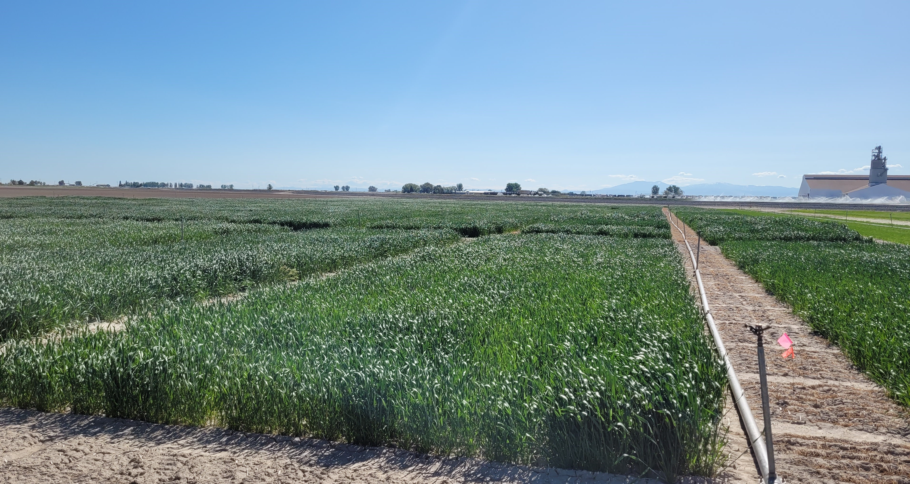

{.img-wpg img alt="Photo of dense, rectangular wheat research plots extending into the distance on a sunny day in Aberdeen, Idaho. The green wheat appears to be a few feet tall, with clean, mowed borders separating the plots."}
*Image: J Piaskowski*
<!---->

Wheat is an important crop throughout the Pacific Northwest and the US.  Growers seed nearly 1.2 million acres every year, and yearly cash receipts have averaged $600 million in recent years. This places wheat consistently in the top five for on-farm cash receipts of the crops in Idaho. While wheat is produced across the region, production systems vary greatly due to different climates, soils and availability of irrigation. Wheat production systems in Idaho can be broken down into three major areas: Northern Idaho rainfed production systems, Southern Idaho Dryland production systems and Southern Idaho irrigated production systems. 

### Northern Idaho Rainfed Wheat Production Systems

Northern Idaho Rainfed Wheat Production Systems are characterized by 12-24 inches of annual precipitation on fields located between 1,000 – 4,000 feet above sea level. The northern Idaho “Mediterranean Climate” experiences typically mild winters and receives almost all its moisture in the fall through spring months with typically extremely dry summer months. Winter wheat is the most frequently planted crop in this region and soft white wheat is the dominant market class grown. The majority of soft white wheat bushels produced in this production region are exported to Pacific Rim countries for use in noodles, crackers and sponge cakes.
 
### Southern Idaho Irrigated Wheat 

Production conditions in southern Idaho vary with geography and availability of irrigation, and wheat is often considered a rotation crop with higher value row crops such as potatoes and sugar beets. Western Idaho grain production is part of a diverse irrigated cropping system at lower elevations (2-3,000 feet above sea level). Eastward, the upper elevation production systems at elevations ranging from 5,000 to greater than 6,000 feet are primarily limited to dryland grain production. Along the Snake River Plain in eastern and southern Idaho, the irrigated cropping system rotations include potatoes, sugar beets, alfalfa, and other forage crops. The majority of irrigated winter wheat production is soft white winter and hard red winter. The spring wheat classes include hard red spring, hard white spring and soft white spring wheat. In areas where natural precipitation is less than 10 inches per year, irrigation is critical to successful production. Upper elevation areas receive as much as 18 inches of natural precipitation, where grain can be successfully produced in dryland production.

### Southern Idaho Dryland Wheat

Winter wheat is an especially important crop in the dryland cropping areas of southern Idaho. Approximately 125,000 acres are harvested annually, producing over 4 million bushels of grain. Southern Idaho dryland accounts for approximately 20 percent of the total state winter wheat acreage and 10 percent of the total state wheat yield. Most production in this environment is hard red winter wheat, with smaller amounts of soft white winter and hard red spring wheat. Production of hard white winter wheat is negligible at present but may increase in future years.

In addition to the challenges of maintaining profitable farming operations, wheat producers also face the challenge of conserving soil and water resources in this area of rolling landscapes with high wind and water erosion potential. High erosion potential, low crop residue production, and generally low, sporadic precipitation make profitable and sustainable cereal production challenging in this area. The goal of every producer should be to obtain optimum yields that are affordable for both short- and long-term considerations and that maximize the efficient use of available land, management resources, and the environment. This production guide brings together the best available research information on management practices for economic and environmentally sound production of wheat in Idaho.

## Agronomic zones

Learn more about agronomic zones:

* [Agronomic Zones of the Dryland Pacific Northwest - PNW Extension ](https://verso.uidaho.edu/esploro/outputs/996749646401851)\
* [Advances in Dryland Farming in the Inland Pacific Northwest - PNW Extension](https://verso.uidaho.edu/esploro/outputs/996749637401851)\

## Production, acreage, classes, quality

## Markets – domestic and export

[US Wheat - Market Information](https://www.uswheat.org/market-information/)